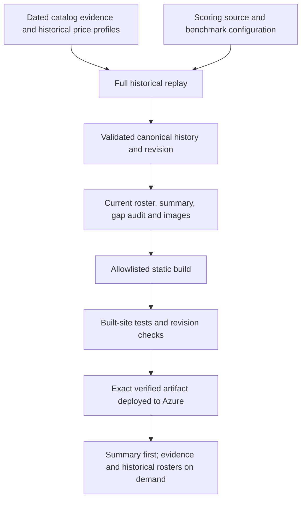

# US vs China AI: understandable rankings and reproducible history

- **Author:** Richard Crane
- **Status:** Reviewed and implemented locally; automated acceptance passed
- **Date:** 2026-11-02

## Overview

Keep the static Azure website and its US–China competition identity. Make the
ranking usable on phones, put evidence beside scores, make historical dates easy
to find, and ensure the website only publishes data produced by the current
scoring algorithm. Retain Python ingestion and scoring, vanilla browser
JavaScript, the shared model catalog, dated roster references, and existing
research and social publishing workflows.

The owner authorized all drafting decisions and implementation of Goldfish
recommendations. This document records proposed behavior, not completed work.
It uses the repository and the preceding interface critique as its source notes;
there is no separate predecessor concepts brief. Architecture decisions below
are drafting decisions, not claims that alternatives were previously rejected.

## The Problem

The main ranking requires horizontal scrolling on a 390px screen to see its
primary score. Large introductory content delays the comparison. National totals
look definitive before readers learn that they sum only models in the global
Top 10. Benchmark sources exist in storage but the details renderer targets a
missing HTML element. Sorting and archive expansion use mouse-only handlers.
The archive renders hundreds of dated cards rather than offering date lookup.

The latest committed snapshot is September 26, 2026, and the archive contains 255
snapshots. This is a repository observation, not verification of production.
The 10,013-byte current roster requires a 4,803,910-byte catalog to show model
metadata. The trend separately reads the 2,129,226-byte archive. Styling and charts
depend on external scripts. Deployments are not gated by their own test job.

Historical scores are derived data. Leaving old dates scored under an old
algorithm would make comparisons misleading. **Every scoring algorithm change
must trigger a full rescore of all retained history before publication.** This
includes weights, benchmark selection, normalization, missing-result treatment,
Value calculations, and evidence-selection rules. This is a release invariant,
not an optional maintenance task or a recent-days-only operation.

## Goals

1. At 390px width, show a model's global rank, name and Unified score together
   without horizontal page scrolling. Show a compact national comparison before
   secondary navigation, news and sharing.
2. Explain the Top 10 national aggregation beside its totals; show evidence,
   benchmark coverage, prices and score definitions without losing the ranking.
3. Make all exploration possible using keyboard and screen-reader controls.
4. Let a reader choose any retained UTC date and intraday snapshot without
   rendering every expanded or collapsed roster at once.
5. Show latest rankings and the 30-day trend without downloading the full model
   catalog or full raw archive. Load supporting evidence only when requested.
6. After any algorithm change, replay every snapshot with the new algorithm,
   retain its original date, model membership and historical price profile,
   regenerate dependent outputs, and block inconsistent publication.
7. Test and deploy the same website artifact; ship local styling and chart assets
   and keep research tools, agent instructions and credentials out of it.

## Non-Goals

- Changing the current formula, the eighteen current benchmarks, their weights,
  eligibility, model families, or the rule for selecting the highest verified,
  date-applicable evidence. Changing these later invokes the mandatory replay.
- Replacing Azure Static Web Apps, adding a backend/database, authentication,
  subscriptions, a JavaScript application framework, or new model research.
- Reconstructing old rosters with models that were absent on those dates, using
  today's prices for old dates, or copying future evidence into earlier dates.
- Publishing social posts as part of development, verification or review.
- Claiming that the selected weighting scheme is an unbiased measure of national
  AI leadership. The existing methodology records ranking-targeted adjustments.

## Open Questions

No owner decision blocks this draft. Production freshness, current Azure access,
and live publishing credentials remain deployment acceptance checks; source
inspection does not establish them. No scoring-policy change is proposed.

## Critical User Journeys (CUJs)

### CUJ 1: Understand today's comparison on a phone

- **Given:** A 390px viewport and valid published data.
- **When:** The reader opens the leaderboard.
- **Then:** They see the snapshot date, freshness state, national totals qualified
  as global Top 10 sums, and compact model rows with Unified visible. Filters
  alter the displayed roster, not the national aggregation. Ties say “Tied.”

### CUJ 2: Inspect a model's evidence

- **Given:** A visible model row and a selected snapshot.
- **When:** The reader opens its native details control.
- **Then:** The page shows historical input/output prices, reported/18 coverage,
  benchmark weights, reported results or “Not reported,” source links and
  availability dates. Missing results remain missing evidence, while their score
  contribution is zero. A detail failure offers a local Retry and leaves the
  ranking usable. Undocumented confidence or AI authorship is never invented.

### CUJ 3: Find and compare historical observations

- **Given:** Multiple snapshots, including intraday observations and missing days.
- **When:** The reader selects a UTC date and snapshot time in Archives.
- **Then:** One roster is shown, with a second optional comparison date/time.
  Controls preserve exact timestamps in the URL. Absent dates do not synthesize
  records. A comparison labels both dates and uses the same current algorithm.

### CUJ 4: Change scoring and publish coherent history

- **Given:** Any scoring input or algorithm code changes.
- **When:** The maintainer prepares a publication or CI verifies the candidate.
- **Then:** Every retained snapshot is rescored, not just the newest or a time
  window. All snapshots, current data, summaries, charts and generated images
  agree on the scoring revision. Any replay, validation or generation failure
  prevents publication and retains the last deployed artifact.

### CUJ 5: Explore using keyboard or degraded connectivity

- **Given:** A keyboard user, reduced-motion preference, or a failed data request.
- **When:** The user sorts, filters, opens details, reads a chart or retries.
- **Then:** Native controls work with visible focus, state is announced, chart
  values have a text/table equivalent, and loading/error states never masquerade
  as zero scores. Cached content is labeled with its snapshot date and an offline
  indication; first-time offline use is not presented as supported.

## Technical Plan (Architecture)

### Existing scoring contract and historical meaning

The current Avg IQ is the fixed-weight sum of the eighteen configured percentage
scores with a constant denominator. Missing components contribute zero. Value is
Avg IQ divided by (historical input price + historical output price), with both
prices expressed per million tokens.
Unified blends cohort-normalized IQ and Value at 90/10 and scales to 0–1000.
National totals sum a country's entries in the combined global Top 10.

Use `data/core_benchmarks.json` as the benchmark/weight authority and the existing
Python scorer as the calculation authority. Do not independently reimplement the
formula in the interface. Display Avg IQ as a weighted 0–100 index, not an
unexplained “normalized IQ.” Display raw Value with its units and explain that
normalization occurs inside Unified. An unpriced model's Value displays
“Unavailable: pricing not reported”; its Unified still includes the existing
zero Value contribution. Its existing numeric calculation remains unchanged.

All retained dates are **recalculated history under the current algorithm**,
not an immutable archive of the scores originally published on each date.
Display that sentence near the historical graph and archive date controls.
Historical model membership, profile prices and evidence availability remain
date-specific. Explain editor-selected weights and link to their adjustment
history. Do not describe rankings as neutral or independently calibrated.

### Mandatory scoring revision and full replay

Add a scoring revision helper that hashes exact benchmark configuration bytes
and the source modules that determine scoring and evidence applicability:
`scoring.py`, `avg_iq_benchmarks.py`, `benchmark_names.py`, `rescore_history.py`,
`model_store.py`, `backfill_gap_fill.py`, and `preconditions.py`. Include their
complete transitive local import dependencies and Python dependency pins.
Conservative extra rescoring after a nonsemantic edit is acceptable. The digest
must not depend on generated timestamps or output scores. Add a test that
inventories local imports in these modules so a newly introduced scoring
dependency cannot silently escape revision tracking.

Persist the revision on each snapshot's scoring metadata and in
`data/scoring_revision.json`. It is separate from the existing numeric schema
and scoring version. Missing revision metadata is a legacy state requiring one
full replay; do not label old scores as current by writing a digest alone.

`rescore_history.py --write` must rebuild every retained snapshot from dated
catalog evidence when the revision differs or any snapshot has missing/mismatched
metadata. It also supports an explicit full rebuild. Preserve exact roster IDs,
profile IDs, snapshot timestamps/order and stored profiles; compare them before
and after replay. Regenerate the gap audit and lightweight site summary from the
same results. Source observation identities and exclusions must survive.

Publication verification always runs a full replay in an isolated temporary copy
and compares its canonical score outputs with the candidate, even when digests
match. This catches missed dependencies and stale computed data. If committed
outputs are stale, save a readable diff/report and fail the check. The maintainer
must include the regenerated data in the algorithm change; CI must not publish
uncommitted corrections under a source SHA that lacks them.

The daily scrape and historical maintenance workflows invoke full replay before
their data commit. Keep paid research budgets unchanged. A manually requested
historical window must not limit algorithm migration. Image generation runs
after successful replay, before data publication. Failures do not advance the
publication revision. Do not post or delete existing remote social content.

Keep the canonical model-store transaction and its legacy-journal compatibility.
Add a publication preparation command that copies inputs to a temporary directory
outside the checkout, replays there, generates the audit/summary and images/social
outputs there, then validates the complete staged generation. It must not invoke
network research or remote publishing. An image failure leaves source publication
outputs and their publication manifest untouched.

Install validated outputs using a durable publication journal with an explicit
relative-path allowlist. Recover an interrupted installation before accepting
another publication. Install the publication manifest last; a revision stamp on
canonical rows alone does not certify a publishable generation. Git remains the
rollback source. Reverting an algorithm also requires replay; restoring an entire
previously validated artifact is the immediate site rollback.

### Lightweight public summary and deferred evidence

Generate `data/site_summary.json` as a disposable projection of canonical data.
Its schema contains a schema version, scoring revision, latest snapshot timestamp,
the latest roster's resolved metadata/derived scores, and a compact index of all
snapshots with exact timestamps, country totals and contributing-model counts.
Include pricing/coverage in current rows, stable model/profile IDs, benchmark
definitions and weights, and a catalog fingerprint. Exclude full evidence and
historical rosters. Keep its uncompressed size below 250 KiB for this repository's
retained corpus; fail an explicit payload budget check rather than silently
truncating history. This is a target to verify, not a measured completed result.

Home and Archives load this summary first. The trend derives the latest snapshot
per UTC day from its index, retaining the existing 30-calendar-day window ending
at the newest recorded day. No missing day becomes a zero score; text explains
that lines connect recorded observations. The table equivalent exposes exact
timestamps and national totals. The matrix uses the summary's current rows.

Only opening a historical roster or evidence requests the raw archive/catalog.
Retain existing raw JSON endpoints for compatibility. Shared JavaScript validates
HTTP status, schema, references, finite values and revision before rendering;
failed requests are evicted from caches so Retry can succeed. A raw/summary
revision or catalog mismatch asks the reader to refresh instead of combining
generations. Failure of evidence must not erase a loaded ranking.

`data/publication.json` is the publication manifest. Its generation ID is the
SHA-256 of canonical source-data digests plus the scoring revision; its artifact
map records byte digests for current/archive/catalog/configuration, summary,
gap audit, revision record, generated images and the selected social plan/slides.
The summary carries the same generation ID. Avoid self-referential hashes: the
manifest does not hash itself and the generation ID does not depend on summary
or rendered-image bytes. Browser loaders fetch the manifest first and compare
actual summary/deferred-response byte hashes against its artifact map. A new
snapshot with unchanged catalog bytes still produces a distinct generation.
Cache and Retry state is scoped to that generation, not merely its algorithm.

Identity inputs are exactly `models.json`, `current.json`,
`data/model_catalog.json` and `data/core_benchmarks.json`, plus the scoring
revision. Hash exact UTF-8 file bytes for each path. Frame the generation input
as UTF-8 JSON with sorted keys, compact separators and no extra whitespace:
an object containing `scoringRevision` and `sources` (path-to-byte-digest map).
Hash those framed bytes with SHA-256. Profiles, exclusions, evidence dates and
roster membership are covered because their containing source files are inputs.

Reuse Python `model_store.benchmark_columns()` and browser `ModelStore.hydrate()`
for evidence resolution. Both exclude rejected observations and observations
whose availability date is after the snapshot's applicable date, then select
highest score, earliest availability, and lexicographically smallest evidence ID.
Details expose that selected ID and its actual source, configuration and dates.
The browser must not choose an arbitrary source or implement a second scoring
formula. Add parity fixtures for competing equal scores, exclusions, future
availability, missing results and benchmark-version distinctions.

Freshness uses the selected/latest snapshot timestamp, never the build time.
Keep the existing visible stale threshold of 26 hours and operational alert
threshold of 30 hours. Historical selections are labeled historical, not stale
live results. Missing/invalid timestamps produce a data error; timestamps over
five minutes in the future show a clock/data warning instead of a fresh label.

### Interface structure and visual direction

Preserve the dark slate background, US blue, China red, compact italic wordmark
and score-led typography. Home and Archives are task interfaces; About and legal
pages are reading surfaces. Reduce duplicate glows, nested panels and oversized
headings. Use existing system/Inter fallbacks rather than adding remote fonts.

Home order: compact navigation; title/date/freshness; two-country summary;
leaderboard and controls; optional model details; trend; matrix; companies;
methodology; news and sharing. On small screens use two compact national columns
and rows with model/rank/Unified always visible. Secondary row metrics appear
below or through details. Sorting uses buttons inside header cells with
`aria-sort`; filters use `aria-pressed`. Country filters retain global ranks.
Sorting a view never changes which models count toward national totals.

Use native details or buttons for all disclosures. Evidence is rendered as text
and safe HTTP(S) links, never unchecked HTML. Explain source type only when
recorded. A `historical-evidence` observation does not imply AI-filled evidence.
Show confidence only if the stored record supplies it. Touch and keyboard users
must see the same descriptions as pointer users. Share actions have persistent
accessible names and clipboard failures show a selectable URL.

Archives uses date/time selectors and compact previous/next controls, one selected
roster and an optional comparison panel. Initialize to the latest date; intraday
choices remain available. Validate URL parameters and fall back with an explicit
message when a requested timestamp is absent. Compare rank, Unified and country
totals; label new/absent membership rather than inventing a zero or rank.

Keep news secondary, with a visible pause control if motion remains; remove it
from About, Privacy and Terms. Respect reduced motion. Use a roughly 70-character
reading column on these pages. Preserve existing legal claims and wording.
Retain the focused 404 recovery behavior. Provide skip-to-content links, landmarks,
visible focus, meaningful loading states and chart summaries/tables. Aim for
WCAG 2.2 AA and verify it; do not infer compliance from the static detector.

### Static assets, publication and operations

Add a small deterministic build: exact existing Tailwind 3.4.16, Chart.js 4.4.7
and Lucide 0.454.0 packages with an npm lockfile. Compile CSS and copy chart/icon
scripts locally. A Python site builder writes `dist/` from a public-file
allowlist; it does not copy the repository wholesale. Include six HTML pages,
required JS/CSS/vendor assets, manifest/icons, metadata, generated images,
published social slides, and the existing raw/public JSON paths. Exclude
`.agents/`, `.github/`, tests, research intake logs, credentials and pending
transactions. Ensure Instagram's current public slide URLs still resolve.

The deployment workflow installs dependencies, validates data/revision, builds,
tests the built artifact, then deploys that exact artifact in a dependent job.
Verification may run in parallel elsewhere, but deployment never depends only on
an unrelated workflow name. Keep preview deployments limited to trusted
same-repository PRs; do not expose deployment secrets to untrusted fork code.
Preserve PR-environment cleanup.

Keep push/manual deployment entry points. If scrape/backfill completion remains a
trigger, resolve a main-branch candidate SHA once, then verify/build/deploy that
same SHA; never use an earlier workflow's initial SHA to represent its later
generated data commit. Serialize production delivery and prevent a superseded
candidate from replacing newer production. Retain the half-hour uptime/freshness
monitor and add revision/summary agreement checks. Dependency freshness warnings
must not stop the routine scraper.

Version the service-worker cache for the new shell. Cache local runtime assets
and summary only after a complete usable generation is available. Do not claim
first-visit offline operation. Raw multi-megabyte archives/catalogs are fetched
on demand rather than precached. Keep request caches bounded and offer a refresh
when a new generation is available; never synthesize a successful data response.

The site builder adds `shellArtifacts` (path-to-byte-digest map for the complete
local six-page shell, JS/CSS/vendor runtime, manifest/icons and summary) and
`shellRevision` to the built publication manifest. The shell revision hashes the
same sorted compact map. Its cache identity combines generation and shell
revision, so a frontend-only update also produces a new shell cache.

On install and after successful online navigations, a single in-flight worker
refresh fetches the manifest and all required shell files into a new cache,
verifies each hash, and stores the manifest there. Only after all requests succeed
does it update an active-cache pointer stored as one cache entry in a small
metadata cache. Never write individual online responses into the active cache.
Failed staging is deleted and the old pointer remains valid. Keep at most two
complete generations plus one in-progress staging cache. Offline requests use
the active complete generation, with `/` mapped to `index.html`; uncached raw
evidence returns a recoverable network error rather than a false JSON response.
Network-first online reads remain hash-checked by `SiteData`.

## Alternatives Considered

### Preserve the current pages and only adjust spacing

Smallest diff, but it leaves hidden evidence, keyboard exclusion, heavyweight
initial fetches and stale-history publication risks. Retain the visual identity
and static approach while repairing those underlying behaviors.

### Introduce a framework, API service and database

Could support server-side queries and accounts, but neither is required by the
current public dataset. It adds hosting, migration and operational costs. Use
generated summaries and lazy detail loads; revisit if measured payload budgets
cannot be met or private/personalized workflows become requirements.

### Preserve original historical scores after an algorithm change

Useful for studying past published claims, but directly conflicts with the
owner's requirement. Rescore all retained history and label it accordingly.
Git records prior publications; the product does not show mixed-algorithm lines.

### Recompute scores independently in the browser

Avoids regeneration steps but duplicates Python policy and makes evidence/date
rules easier to diverge. Publish derived scores with revision metadata and test
them against Python replay. Browser code only sorts, filters and aggregates.

### Generate a separate complete evidence copy for every date

Would reduce interaction-time work but duplicates the largest dataset and creates
many consistency surfaces. Keep a small shared summary and load the canonical
archive/catalog only for explicit historical or evidence exploration.

## Non-Functional Requirements

- **Correctness:** No algorithm migration publishes partially rescored history.
  Repeating a replay changes no canonical scores, rosters or evidence. Preserve
  stored precision; round for display consistently, not before aggregation.
- **Performance:** Initial summary below 250 KiB; initial ranking/trend requests
  exclude full archive/catalog. No external executable/styling dependency is
  required for the deployed interface. Measure real artifact sizes and requests.
- **Accessibility:** Keyboard-operable exploration, labeled state, chart
  equivalents, visible focus, 200% zoom and no page overflow at 320–390px.
- **Privacy/security:** No new personal-data collection. No secrets or research
  runtime in the static artifact. Reject unsafe evidence URLs. Preserve legal
  text; any future policy change needs a separate content decision.
- **Failure isolation:** News, details, clipboard, charts and social rendering
  errors cannot replace a valid ranking with zeros. Required score/image
  generation failures block a new publication.
- **Rollback:** Keep the previous validated site artifact; restore it as a whole.
  Source reversions include another full replay, not a hand-edited score repair.

## Additional Resources

- [Current product and quick start](README.md)
- [Canonical storage and dated evidence](docs/model_storage.md)
- [Current scoring and adjustment history](docs/two_pass_scoring.md)
- [Evidence discovery and gap filling](docs/ai_gap_filling.md)
- [Tests and recovery contracts](docs/testing.md)
- [Configured benchmarks](data/core_benchmarks.json)

## Detailed Implementation Plan

Implement in the dependency order below. These are the intended source changes;
generated data/images are outputs of the same steps, not manually edited inputs.
The implementation below has been completed locally following Goldfish review;
see [review and acceptance](consolidated_review_report.md) for the actual checks.

### Shared implementation contracts

- Summary schema version is integer `1`. Top-level fields are `schemaVersion`,
  `scoringRevision`, `generationId`, `catalogFingerprint`, `metadata`, `teams`,
  `columns`, `benchmarks`, `current` and `history`. Preserve existing metadata,
  team definitions and display-column definitions. `benchmarks` contains the
  configured `id`, `name`, `column` and numeric percentage `weight`.
- `current` has `timestamp`, `scoring` and `teams.US`/`teams.CN`. Each row contains
  its original profile metadata plus `modelId`, `profileId`, `avgIq`, `value`,
  `unified`, `coverage` and `provisional`; it excludes raw benchmark evidence.
  `history` contains newest-first entries with exact `timestamp`, `scoringRevision`
  and `scores.US`/`scores.CN`. Each country's scores contain `total`, `count`,
  `avgIq` and `avgValue` for its contributing global Top 10 models. Preserve
  stable existing roster order when equal Unified values tie at tenth place.
- Publication manifest schema version is `1`, with `generationId`,
  `scoringRevision` and `artifacts`, a relative-path-to-SHA-256 map. Paths are
  restricted to explicitly published files; no absolute paths or `..` segments.
  `current.json`, `models.json` and each snapshot carry matching scoring
  revision metadata. Summary and manifest generation IDs must match.
- `SiteData.loadSummary()` returns a validated summary;
  `SiteData.loadCatalog()` returns the verified deferred catalog;
  `SiteData.loadSnapshot(timestamp)` returns a hydrated snapshot with stable
  `modelId`/`profileId` retained alongside display rows. For the latest timestamp,
  load `current.json`; otherwise lazily load `models.json`. Reuse the existing
  `ModelStore` resolver. Expose `SiteData.reset()` for an explicit generation
  refresh. Each failed promise is removed from the cache. A generation mismatch
  throws a readable refresh-required error, never silently combines records.
- Display scores to two decimal places for Unified/totals and one decimal for
  IQ/Value. Sort on stored unrounded numeric values. Use US then CN roster order
  as the stable fallback for equal Unified values, consistent with current home.
- Archives URL fields are `at` (exact snapshot timestamp) and optional `compare`
  (exact second timestamp). Date inputs select the latest snapshot on that UTC
  date; time selectors expose all observations on that date. An invalid/missing
  requested date shows an explanatory message and selects the latest retained
  timestamp. Invalid sort/filter URL values fall back to Unified-descending and
  Top 10. Home URL fields are `filter`, `sort` and `direction` with existing
  supported values; browser Back restores view state.
- `prepare_publication.py` stages only scripts/templates and explicit data/image
  inputs. Its durable journal is `.publication-pending.json`, containing validated
  destination-relative paths and complete intended bytes encoded as base64,
  written atomically. Recovery verifies path/digest integrity, installs all data
  and images atomically per file, then installs `data/publication.json` last and
  removes the journal. Reject symlink destinations. Tests cover partial
  installation and retry; the static builder refuses a pending journal.

### Implementation sequence

1. **Scoring revision and replay enforcement.** Create
   `scripts/scoring_revision.py`, `scripts/prepare_publication.py` and
   `scripts/research_history.py`; modify `scripts/rescore_history.py`,
   `scripts/model_store.py`, `scripts/validate_models.py` and
   `tests/test_model_store_integration.py`; create
   `tests/test_scoring_revision.py`, `tests/test_publication.py` and
   `tests/test_research_history.py`. Implement digest calculation, full rebuild
   on mismatch, per-snapshot revision stamping, isolated replay comparison,
   invariant checks and recoverable, staged full-publication installation. Every
   inventoried Python function/method, including private helpers, follows the
   existing precondition conventions. Include `tests/test_app_preconditions.py`
   in modified files if contract samples need additions; avoid unnecessary new
   contract rule types.
   Preserve legacy fixture and pending-journal compatibility.

   The publication command is `python scripts/prepare_publication.py --write`.
   Without `--write` it verifies in scratch space and reports stale outputs,
   exiting nonzero if installation would change canonical data/publication.
   A changed revision always performs a full rebuild; verification also replays
   all dates independently when the revision matches. Root-directory parameters
   on helpers support isolated tests. Staging must use the same scoring code and
   dependencies as the candidate checkout, without copying secrets or `.agents`.
   Execute the complete copied `scripts/` tree in a fresh subprocess so module
   root constants and cached configuration resolve inside staging. Explicit
   inputs include canonical data, `news.json`, `data/social_history.jsonl`,
   `social/plan.json`, existing image inputs, OG/IG templates and all
   `scripts/social-templates/` files including `_base.css`. Tests deliberately
   give staging different values and verify the checkout remains untouched.
   Create repository `AGENTS.md` to preserve the owner's mandatory-rescore rule
   in the shared agent-instruction location. Add `.publication-pending.json` to
   `.gitignore`; it is private recoverable writer state, never a public asset.
   Verification compares replayed canonical JSON and checks installed image-byte
   digests; it does not demand identical PNG bytes across operating systems.
   Writing a new algorithm generation must render images in staging successfully.

2. **Public projection and browser loader.** Create
   `scripts/site_summary.py`, `js/site-data.js` and `tests/test_site_summary.py`;
   modify `js/model-store.js` only where evidence metadata must be retained for
   details. Generate stable model/profile references, current display rows,
   exact-timestamp summary entries, weights, counts and fingerprints. Never
   drop older timestamps to meet a payload budget. Verify projected totals
   against the actual global Top 10, including ties and fewer-than-ten rosters.

3. **Home and evidence UI.** Modify `index.html`; create
   `tests/test_dashboard_accessibility.py`. Move secondary/promotional content,
   implement compact mobile rows, loading/error states, model details and
   evidence Retry; use summary data for ranking, matrix, companies and trend.
   Preserve current filter/sort behavior and score precision. Add native sorting,
   filter state, clipboard recovery, safe links and chart equivalents. Adapt
   `tests/test_browser_integration.py` and `tests/test_empty_leaderboard.py` to
   the real new data path, retaining malformed transport and recovery coverage.

4. **Historical lookup and reading surfaces.** Modify `history.html`,
   `about.html`, `privacy.html`, `terms.html` and `404.html`; create
   `tests/test_archive_navigation.py`. Replace mass card rendering with exact
   UTC selection and comparison, lazy roster details and valid URL state.
   Preserve all historical observations. Explain recalculated history, date gaps
   and current method; unify missing pricing display. Add landmarks/focus and
   readable legal layouts; remove news from reading pages without rewriting
   legal content.

5. **Local assets and build.** Create `package.json`, `package-lock.json`,
   `tailwind.config.cjs`, `css/site.css`, `scripts/build_site.py` and
   `tests/test_site_build.py`; modify the six HTML files above to reference
   local asset URLs. Compile all existing/generated utility classes, using an
   explicit safelist for runtime class names. The site builder validates its
   allowlist, input revision and required public paths before returning success.
   `dist/` remains ignored by the existing `.gitignore` build rule. Browser
   fixtures copy the compiled assets and serve the same layout as deployment.

6. **Publishing and cache coherence.** Modify `.github/workflows/deploy.yml`,
   `.github/workflows/tests.yml`, `.github/workflows/daily-scrape.yml`,
   `.github/workflows/backfill-gap-fill.yml`,
   `.github/workflows/health-check.yml`, `staticwebapp.config.json`, `sw.js`,
   `tests/test_daily_scrape_workflow.py`; create
   `tests/test_deployment_contract.py`, `tests/test_service_worker.py` and
   `tests/test_built_site_acceptance.py`. Enforce replay, required image refresh,
   summary validation and exact-artifact deployment. Preserve merge-based writer
   synchronization, existing budget behavior and PR cleanup. Do not manually
   request PR reviews. Update `tests/test_requirements.py` only if required to
   inventory the added pinned build dependencies.
   Daily ordering is scrape/research, full replay, publication preparation,
   verification, then commit/push. Select `rescore_history.refresh_images()` as
   the offline rendering path: freeze time to the newest snapshot, use the
   existing deterministic caption fallback and staged rotation history, and
   invalidate stale paid-caption cache. Do not invoke `social_publish.publish()`
   in preparation or routine post-preparation steps. Paid benchmark research
   budgets remain unchanged; optional standalone caption tooling remains
   available outside this publication path. All image/slide rendering and
   manifest creation happen in preparation. Remove later steps that mutate
   public files after certification. Verification and build never perform paid
   research or remote social publication.

7. **Generated artifacts and explanation.** Regenerate `models.json`,
   `current.json`, `data/historical_benchmark_gaps.json`, `og-image.png` and
   `ig-image.png`; create `data/scoring_revision.json` and
   `data/site_summary.json` and `data/publication.json`. Regenerate applicable
   existing `social/` slides and
   plan through the current renderer, keeping publication disabled and captions
   accurate to the revised facts. Modify `README.md`, `docs/specifications.md`,
   `docs/model_storage.md`, `docs/two_pass_scoring.md`, `docs/testing.md` and
   `site.webmanifest` to match actual behavior and the 03:17 UTC scrape schedule.
   Keep current configured weights and evidence unchanged. Update this draft
   and the Goldfish report with actual resolutions and remaining limitations.

### Verification Plan

- Run existing Python tests and canonical validation. Use deterministic fixtures
  for browser tests; do not perform paid research or social posting in tests.
- Mutation-test revision detection for weights, scorer logic, evidence selection
  and tracked imports. Require a full replay even when a changed algorithm
  happens to produce identical numeric scores. Legacy metadata requires a real
  replay. A mismatched older snapshot alone blocks publication.
- Compare every retained timestamp, country/model/profile identity and price
  profile before/after replay; test future/undated evidence boundaries, exclusions,
  replay repeatability and interrupted multi-file recovery.
- Verify summary/current/archive/country totals and metadata all agree with the
  same revision. Reject invalid references, unsafe URLs, nonfinite numbers,
  partial generations and payload-budget violations.
- Browser-test 390px and 1440px, keyboard sorting/filters/disclosure, named share
  controls, date/time URL restoration, intraday snapshots, absent-date fallback,
  comparison membership changes, accessible charts and failed-request Retry.
- Assert no initial full catalog/archive fetch; an evidence failure leaves the
  main ranking usable. Verify no external CDN dependency in the built site.
- Validate the artifact allowlist, all asset links and public social slide paths;
  test that deployment cannot run after a failed check or deploy another SHA's
  artifact. Lint edited workflow YAML and Markdown with project-appropriate rules.
- Inspect the finished site in one combined desktop/mobile pass, fix material
  defects in a batch, and confirm once. Report local/test proof separately from
  Azure deployment and live production acceptance.

Drafted with EGM.
